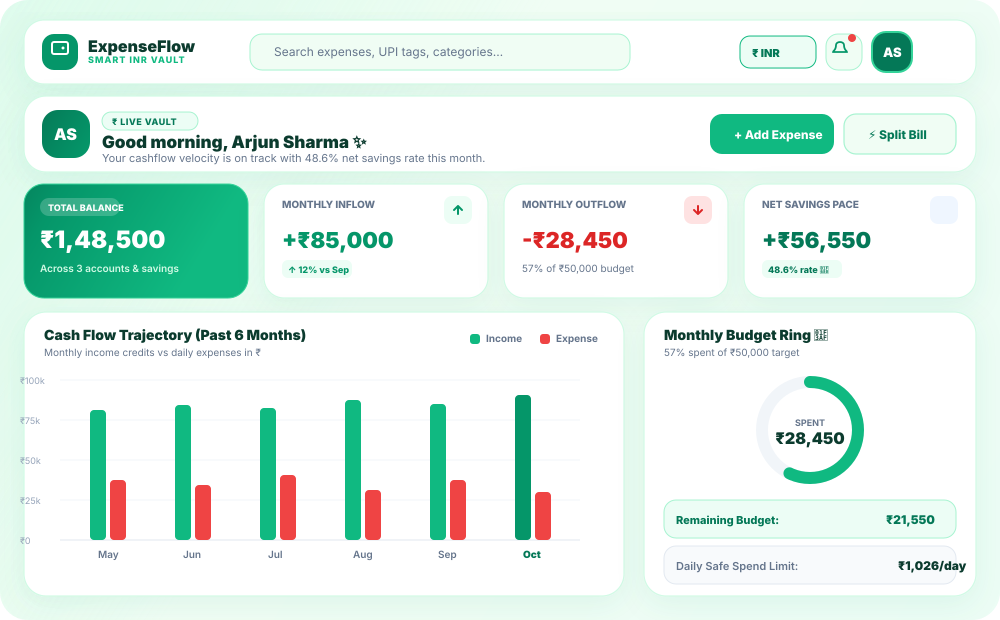
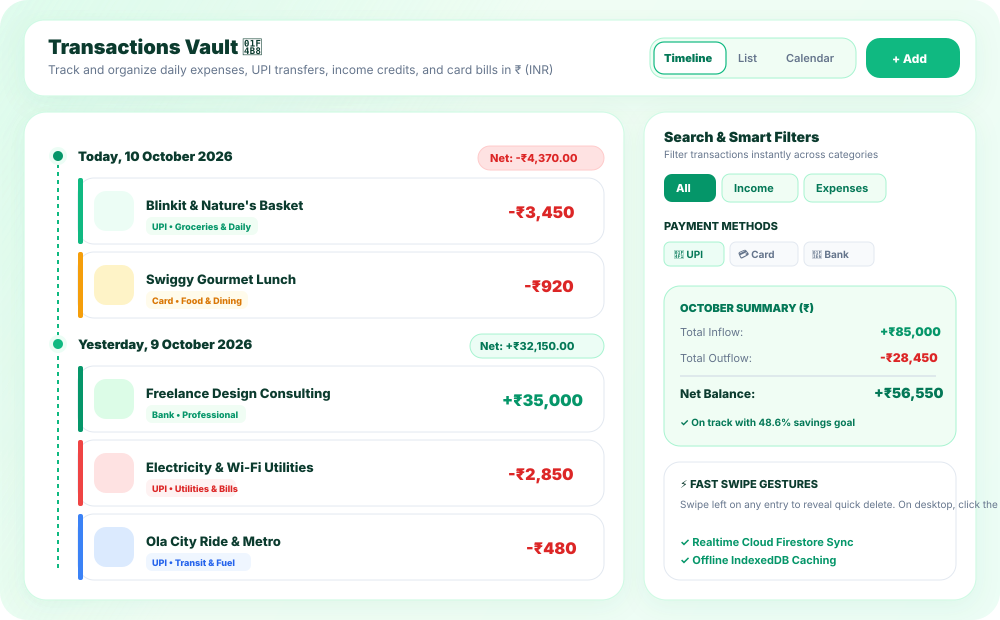
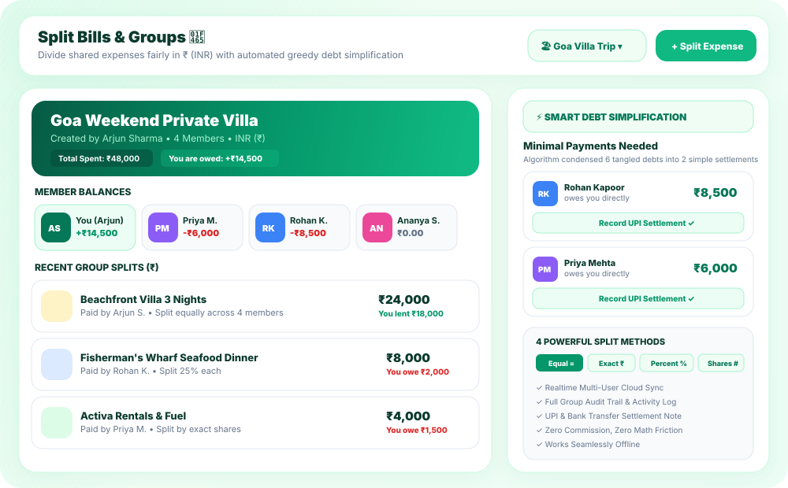
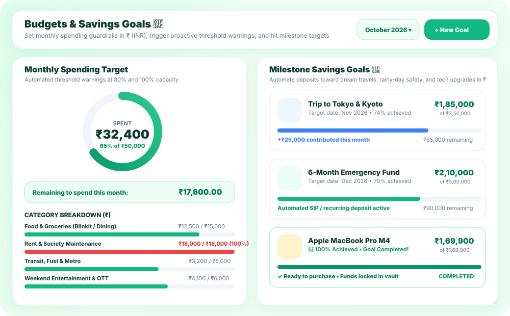
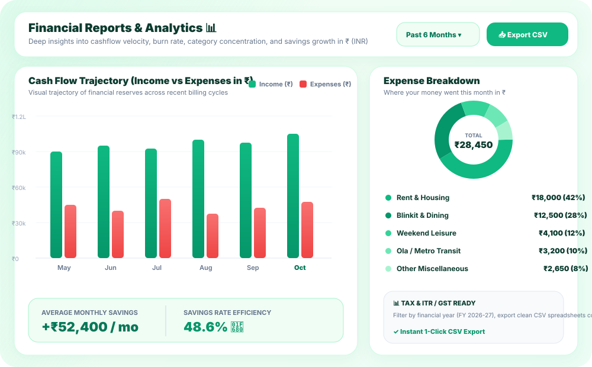
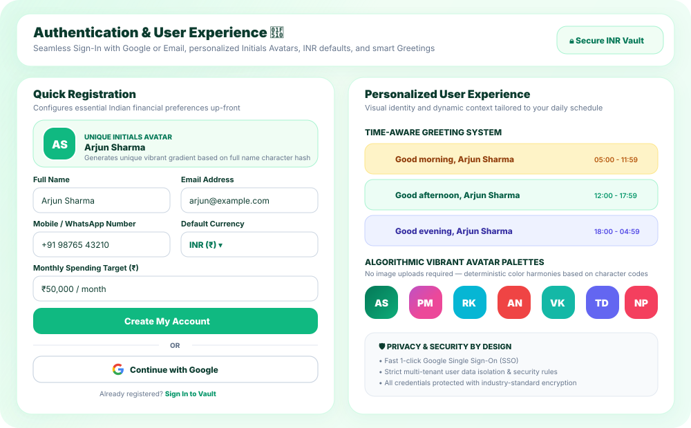

# ExpenseFlow

ExpenseFlow is a personal finance and shared expense app. Track daily spending, split bills with friends, set monthly budgets and save towards goals.

## Features

### Dashboard

A greeting based on the time of day, plus your net balance, monthly income, monthly expenses and what you owe or are owed in groups.

- Greeting changes between "Good morning", "Good afternoon" and "Good evening".
- Stat cards for balance, income, expenses and group debts.
- Cash flow chart comparing income and expenses over time.
- Quick actions to add a transaction or start a group split.

### Transactions

Three views of the same data: timeline, list and calendar.

- Timeline groups transactions by day with a daily net total.
- List is a compact table for scanning.
- Calendar shows a monthly grid with activity dots on busy days.
- Default and custom categories with icons (food, housing, transit, health, entertainment, subscriptions and more).
- Payment method tagging: cash, credit card, debit card, bank transfer.
- Swipe to delete on touch screens.

### Split bills

Create groups for trips, flatmates or dinners. A greedy debt simplification algorithm reduces the number of payments needed to settle up.

- Four split methods: equal, exact amounts (₹), percentage and shares.
- Debt simplification, for example turning 6 tangled debts into 2 payments.
- Activity log of every expense, edit and settlement.
- Settle up by recording a cash or external payment.

### Budgets and goals

- Monthly budget ring showing spending against your cap.
- Alerts at 80% and 100% of the budget.
- Per-category budgets.
- Savings goals (emergency fund, vacation, new laptop, down payment) with progress rings and deposit/withdraw logging.

### Reports

- Six-month income vs. expense bars.
- Category donut chart.
- Top spending categories and peak periods.
- Savings rate for the month.
- CSV export that opens in Excel, Google Sheets and Numbers.

### Accounts

- Google sign-in or email and password.
- Generated initials avatar with one of 14 gradients, picked from your name.
- Profile with default currency, monthly budget and contact details.

## Design

| Area | Notes |
| :--- | :--- |
| Theme | Emerald greens (`#047857`, `#059669`, `#10B981`) with mint highlights. |
| Mobile | Bottom navigation, swipeable cards, bottom sheets and a floating action button. |
| Desktop | Sidebar navigation and multi-column layouts. |
| Loading | Skeleton shimmers and modal transitions. |
| Themes | Light and dark. |
