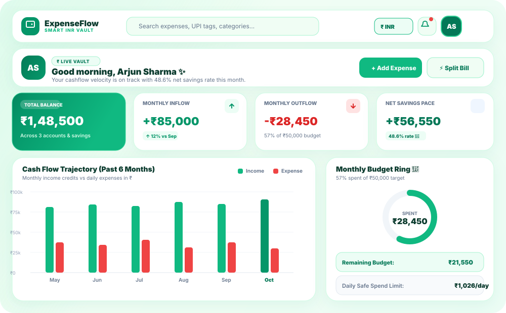
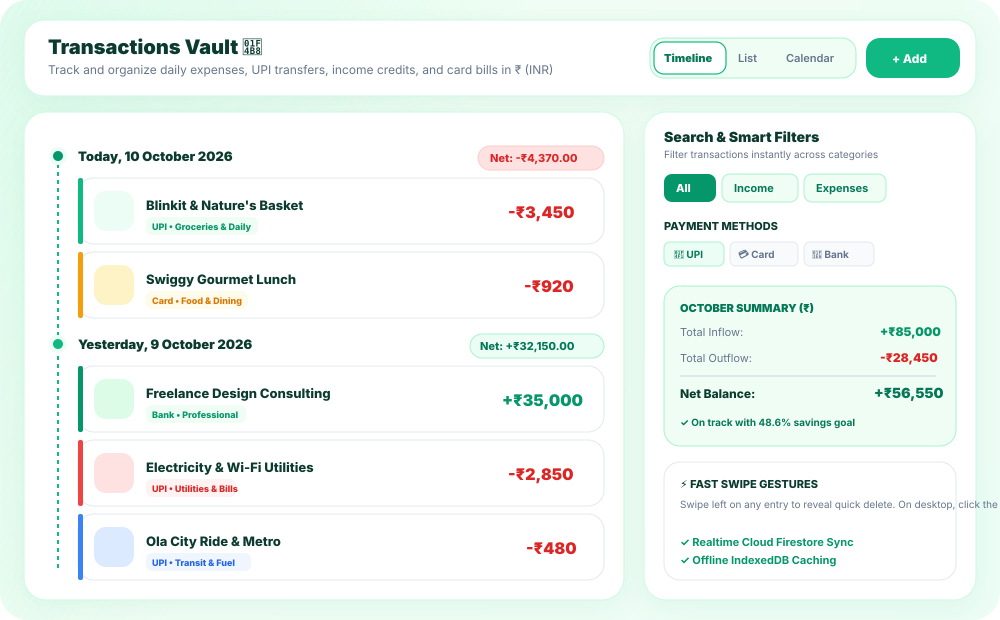
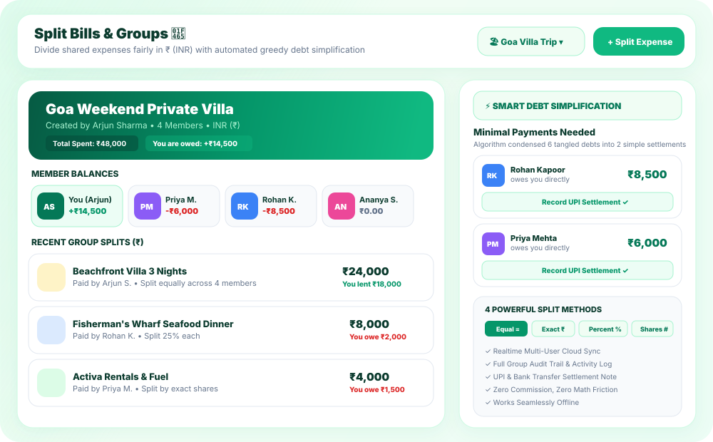
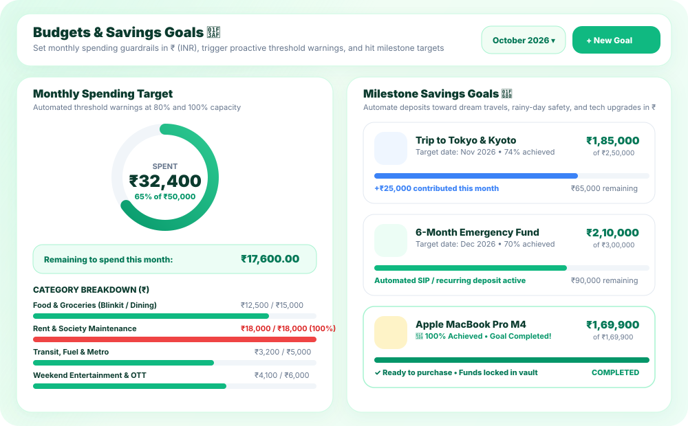
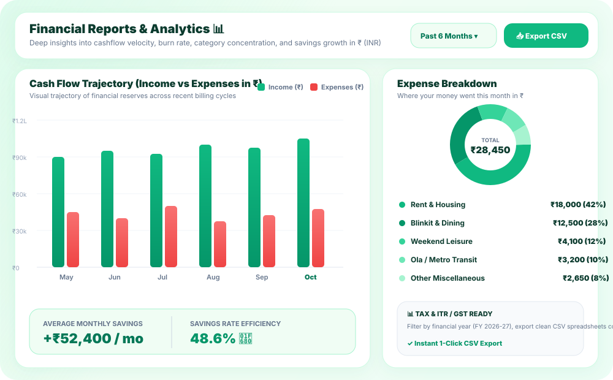
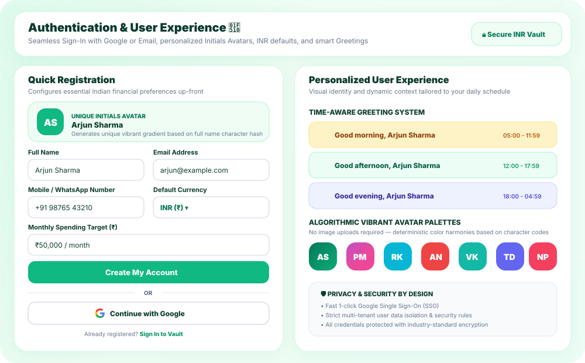

# 💸 ExpenseFlow

<div align="center">



### **Master Your Money. Split Bills Seamlessly. Achieve Financial Freedom.**

ExpenseFlow is an intelligent personal finance and shared expense management platform designed to provide total clarity over daily spending, group trip budgets, roommate splits, and long-term savings goals.

---

[](#-personal-finance-dashboard)
[](#-split-bills--debt-simplification)
[](#-smart-budgets--savings-goals)
[](#-financial-reports--analytics)

</div>

---

## 🌟 Overview & Vision

Managing money across personal spending and shared social circles shouldn't feel scattered or overwhelming. **ExpenseFlow** unifies your entire financial life into a cohesive, beautifully designed ecosystem:

- 🧭 **Realtime Clarity:** Always know where your money goes with instant cashflow totals, visual spend meters, and categorized timelines.
- 🤝 **Effortless Social Splitting:** Never deal with awkward debt discussions again. Divide expenses fairly and settle up with the fewest payments possible.
- 🎯 **Disciplined Wealth Building:** Set monthly safety boundaries and monitor life milestones, from emergency funds to dream vacations.
- 🔒 **Private & Secure:** Your financial data stays isolated, secure, and accessible from anywhere on any device.

---

## 📱 Interactive Screen Showcase & Features

### 1. 🏠 Personal Finance Dashboard
> **Your daily financial command center at a glance.**

The **Dashboard** gives you immediate situational awareness the moment you open the app. An adaptive greeting welcomes you based on the time of day, alongside high-level summaries of your net balance, monthly income, active expenses, and pending group debts.


#### ✨ Highlights
- ☀️ **Time-Aware Personalized Greeting:** Dynamic `Good morning`, `Good afternoon`, or `Good evening` tailored to your schedule.
- 💳 **High-Altitude Stat Cards:** Track total reserves, total monthly inflow, current month outflow, and money owed to you or by you.
- ⚡ **Cash Flow Velocity Chart:** Interactive timeline visualizing income deposits versus expense spikes.
- 🏷️ **Quick Action Center:** Instant 1-click modal access to record new transactions or initiate a group bill split.

---

### 2. 💸 Transactions Vault & Tracking
> **Log, categorize, and inspect every dollar with pinpoint precision.**

The **Transactions Vault** offers three intuitive viewing modes to match how you think about your spending: chronological **Timeline**, streamlined **List**, or interactive **Calendar**.



#### ✨ Highlights
- 🗓️ **Multiple Viewing Modes:**
  - **Timeline Mode:** Grouped day-by-day with daily net spending summaries and visual timestamp markers.
  - **List Mode:** Compact, high-density table for quick scanning and audits.
  - **Calendar Mode:** Interactive monthly grid with activity dots highlighting high-spend days.
- 🏷️ **Intelligent Categories & Icons:** Pre-configured and customizable categories for Food & Groceries, Housing, Transit, Healthcare, Entertainment, Subscriptions, and more.
- 💳 **Payment Method Tagging:** Filter by Cash, Credit Card, Debit Card, or Bank Transfer.
- 👆 **Fluid Swipe Actions:** Smooth swipe-to-delete gestures for fast maintenance on mobile and touch displays.

---

### 3. 👥 Split Bills & Debt Simplification
> **Divide dinners, group trips, and shared rent with zero math and zero friction.**

Splitting costs with roommates, travel companions, or partners has never been easier. ExpenseFlow eliminates confusing payment loops using an automated **Debt Simplification Algorithm** that computes the absolute minimum number of settlement payments needed across the group.



#### ✨ Highlights
- 🌲 **Group Hubs:** Organize expenses into dedicated group workspaces (e.g., *Lake Tahoe Trip*, *Apartment 4B Roommates*, *Weekend Getaway*).
- 🧮 **4 Flexible Split Methods:**
  - **Equal (`=`):** Evenly divided across all group participants.
  - **Exact (`₹`):** Specify individual amounts per member in ₹ (INR).
  - **Percentage (`%`):** Allocate exact percentage weights that sum to 100%.
  - **Shares (`#`):** Ratio-based allocation (ideal for couples or variable stays).
- ⚡ **Smart Debt Simplification:** Condenses complex webs of multi-person debts into direct, minimal transactions (e.g., turning 6 tangled debts into just 2 simple settlements).
- 🧾 **Audit Trail & History:** Comprehensive activity log recording every expense addition, balance edit, and settlement confirmation.
- ✅ **One-Click Settle Up:** Record cash or external settlements with instantaneous balance updates.

---

### 4. 🎯 Smart Budgets & Savings Goals
> **Guard against overspending and watch your dream purchases turn into reality.**

Maintain disciplined spending habits without feeling restricted. ExpenseFlow couples monthly spending caps with visual milestone progress rings to keep you motivated.



#### ✨ Highlights
- ⭕ **Dynamic Monthly Budget Ring:** At-a-glance circular visualizer displaying current expenditure against your monthly cap.
- ⚠️ **Proactive Threshold Alerts:**
  - **80% Caution Zone:** Notifies you as spending approaches your target limit.
  - **100% Budget Breach:** Alerts you when monthly funds are exhausted.
- 📊 **Per-Category Allocations:** Monitor individual allowances for Groceries, Dining Out, Shopping, Utilities, and Travel.
- 🚀 **Milestone Savings Goals:**
  - Create dedicated goals for Emergency Funds, Dream Vacations, Tech Upgrades, or Down Payments.
  - Visual progress rings showcasing percentage achieved and remaining balance.
  - Log incremental contributions with milestone celebration feedback.

---

### 5. 📊 Financial Reports & Analytics
> **Turn raw numbers into actionable financial wisdom.**

Uncover your financial habits with rich visual reports that break down spending patterns over time, identify high-frequency merchants, and track your net savings rate.



#### ✨ Highlights
- 📈 **6-Month Cash Flow Trajectory:** Comparative side-by-side bar analytics contrasting income inflow with expense burn rate.
- 🍩 **Category Concentration Donut:** Instant visual breakdown of spending shares across your primary budget buckets.
- 🏆 **Ranked Spending Insights:** Identify top spending categories and peak expenditure periods.
- 📈 **Savings Rate Metric:** Live calculation of your monthly surplus percentage to track wealth accumulation pace.
- 📥 **1-Click CSV Data Export:** Export clean, tax-ready spreadsheets compatible with Microsoft Excel, Google Sheets, Apple Numbers, and accounting software.

---

### 6. 🔐 Personalized Identity & Secure Access
> **A tailored experience that puts your privacy and ease of access first.**

ExpenseFlow pairs modern security with a welcoming, bespoke user interface that makes managing money feel delightful and personal.



#### ✨ Highlights
- ⚡ **Google One-Click Sign-In:** Effortless authentication using your Google account.
- ✉️ **Secure Email & Password:** Robust credential authentication with complete privacy isolation.
- 🎨 **Algorithmic Initials Avatar:**
  - No profile photo upload required.
  - Generates a distinctive avatar with your initials set against one of 14 vibrant, harmonious color gradients based on your full name.
- 🌅 **Adaptive Daily Greetings:** Contextual greeting banners that refresh as your day progresses:
  - *Good morning, {Full Name}*
  - *Good afternoon, {Full Name}*
  - *Good evening, {Full Name}*
- 🌐 **Comprehensive Account Profiles:** Configurable default currencies, custom budget parameters, and contact information.

---

## 💎 Design System & User Experience

ExpenseFlow was crafted with meticulous attention to visual hierarchy, calm ergonomics, and responsive agility:

| Feature | Design Experience |
| :--- | :--- |
| **Emerald Theme** | Calming, premium emerald greens (`#047857`, `#059669`, `#10B981`) paired with mint highlights to promote clarity and financial confidence. |
| **Mobile-First Gestures** | Bottom navigation bar, swipeable cards, tactile bottom sheets, and responsive floating action buttons. |
| **Desktop Workspace** | Expansive multi-column layouts, contextual side drawers, keyboard shortcuts, and interactive chart drill-downs. |
| **Micro-Interactions** | Smooth modal transitions, skeleton loading shimmers, and tactile feedback on every transaction log. |
| **Light & Dark Harmony** | Crisp typography, high-contrast readability, and clean input controls tailored for everyday usability. |

---

## 💡 How ExpenseFlow Helps You Everyday

```
               ┌────────────────────────────────────────────────────────┐
               │                      ExpenseFlow                       │
               └───────────────────────────┬────────────────────────────┘
                                           │
         ┌─────────────────────────────────┼────────────────────────────────┐
         ▼                                 ▼                                ▼
   DAILY EXPENSES                    GROUP LIVING                    LONG-TERM GOALS
   • Coffee & Groceries              • Roommate Rent & Utilities     • Emergency Safety Net
   • Transportation & Transit        • Vacation Lodging & Flights    • Vacation Funds
   • Recurring Subscriptions         • Group Dinners & Outings       • Vehicle & Home Upgrades
         │                                 │                                │
         ▼                                 ▼                                ▼
   Realtime Log & Trends             Greedy Debt Minimizer           Visual Milestone Tracker
```

1. **Morning Routine:** Check your **Dashboard** to see upcoming subscriptions, budget headroom, and daily allowances.
2. **On the Go:** Record daily coffee, transit, or grocery receipts in seconds using **Timeline Mode**.
3. **Dining with Friends:** Pay the group bill, log the expense with **Equal or Percentage Split**, and let the app calculate who owes what.
4. **End of Month:** Review the **Reports & Analytics Donut** to analyze category spending, celebrate your **Savings Goals**, and export a CSV for your records.

---

<div align="center">

### **Take Control of Your Financial Future with ExpenseFlow** 🌿

*Smart Finance. Fair Splits. Crystal Clarity.*

</div>
